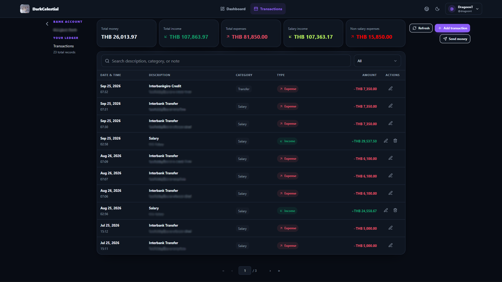
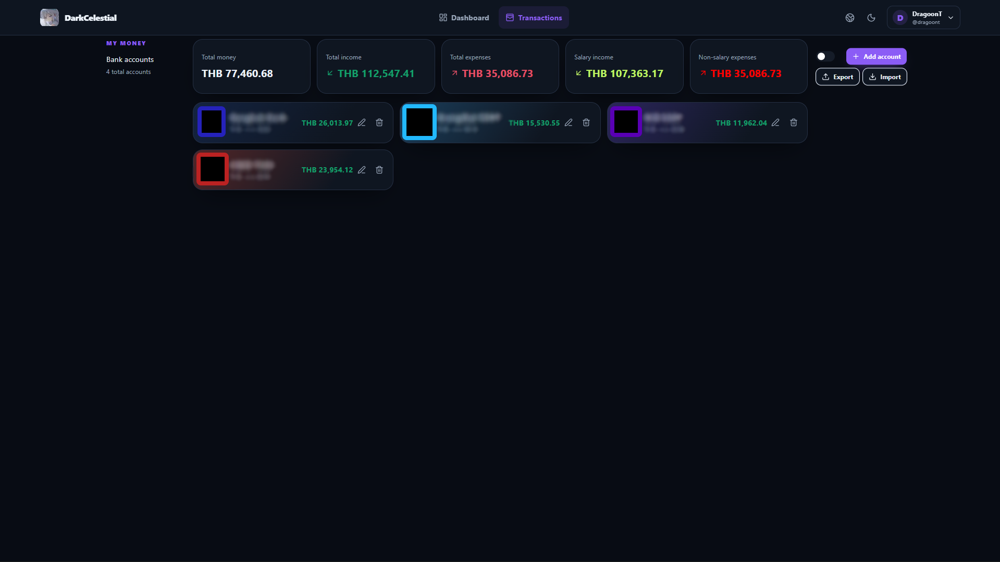

# DarkCelestial · note-ledger

[English](README.md) · [ไทย](README-TH.md)

DarkCelestial is a personal, self-hosted money tracker. You write down what you earn and spend by hand — the app keeps a clean, searchable history of every note, organizes it by bank account, and shows you where your money goes.

It doesn't connect to your bank or scrape anything. Every record is entered by you, which means the history is exactly as accurate as you make it.

## Preview

**Ledger — transaction history you write yourself**



**Bank accounts — balances built from your notes**



## Why DarkCelestial · note-ledger?

- **Manual by design** — no bank connections, no credentials to trust, no sync to break. You add each record yourself, so the history is a notebook you control.
- **History-first** — every entry keeps its date, time, description, category, payment details, and note, so old records stay readable years later.
- **Multi-account** — track several bank accounts side by side and see the total across all of them.
- **Multi-currency** — 10 currencies built in (USD, THB, EUR, GBP, JPY, CNY, KRW, SGD, AUD, CAD). Note: there is **no automatic currency conversion** — each record keeps its own currency, and totals are grouped per currency. If you change a record's currency later, the amount stays the same number; you must edit it manually.
- **Private & self-hosted** — your data lives in your own database. Nothing leaves your server.

## Features

### Ledger (Transactions)
- Add income and expense records with amount, currency, date, time, category, payment channel, and note
- Digit-only amount input: type the whole number and the decimals in separate boxes — no spinners, no auto-formatting
- Optional payment details: paid to/from, transaction references (multiple), Merchant ID, Shop ID, PromptPay, channel details
- Sync a record with a bank account to auto-create the mirrored record (expense ↔ income) on the other account — same description, amount, currency, date and time; the note stays yours to write
- Send money between your own accounts in one step
- Search, filter by type/year/month, and paginate; after saving, the list jumps to the record's page and highlights it
- Draft autosave: if you refresh or close the tab mid-entry, your form comes back
- Edit or delete any record; errors and toasts auto-dismiss after 3 seconds

### Bank accounts
- Create accounts with name, currency, account number, and card color/image
- Balances are computed from your records automatically
- Export/Import backups (JSON) for safekeeping
- Show/hide account numbers

### Dashboard
- Totals for money, income, and expenses
- Salary income vs. non-salary expenses breakdown
- Reports rendered per currency

### Money limits and calculation safety

> **Warning:** one transaction can contain at most **999,999,999,999.99** (12 whole-number digits and 2 decimal digits). The form blocks larger values instead of accepting a value that cannot be handled safely.

- Account balances, summary cards, dashboard totals, and chart tooltip amounts are calculated as exact integer cents with `BigInt`.
- Combined totals can exceed the single-transaction limit without losing cents.
- Chart shapes use floating-point coordinates for drawing only; the monetary values shown in cards, balances, and tooltips remain exact.

### General
- **English & Thai** interface — switch anytime from the top bar or the sign-in screen
- **Light / Dark / System theme** plus a custom accent color
- Admin mode to review all users' records
- Encrypted, password-protected backups
- Session timeout after 10 minutes of inactivity

## Tech stack

- **Frontend:** Next.js (App Router) + React + TypeScript + Tailwind CSS
- **Backend:** Rust (Axum + SQLx) with PostgreSQL
- **Deployment:** Docker Compose / Kiri (`db` + `api` + `web`)

## Getting started

### Requirements

- **A Docker-compatible runtime** and **Docker Compose** (recommended — runs `db`, `api`, and `web`)
  - **Recommended:** [Kiri](https://github.com/libracoder/kiri) — small, fast replacement for Docker Desktop on Windows, macOS, and Linux ([download](https://runkiri.com/releases/))
  - Also works with **Docker Desktop** or a normal **Docker Engine** install

Or, to run without containers:

- **Node.js** 20+ and **pnpm** 11+ — frontend build (Next.js 16, React 19)
- **Rust** stable 2024-edition toolchain — backend build
- **PostgreSQL** 14+ — database

### Run without Docker

With PostgreSQL already running and `DATABASE_URL` pointing to it (host `localhost`, not `db`):

- Terminal 1 — backend (from the project root)

```bash
cd backend
cargo run
```
- Terminal 2 — frontend (from the project root)

```bash
pnpm install
pnpm dev
```

The frontend expects the API at `http://localhost:8080` by default (set `NEXT_PUBLIC_API_URL` to override).

### 0. Container runtime

PostgreSQL runs **inside Compose** as the `db` service (persistent Docker volume). You do **not** need a host PostgreSQL install for the recommended path.

Before starting the website:

1. Start your container runtime and make sure `docker compose version` works:
   - **Kiri (recommended):** open Kiri and click **Start** for the Linux VM (when the VM is Off,
     Compose cannot start). First launch creates a `kiri` Docker context.
   - **Docker Desktop / Docker Engine:** start the engine as usual.
2. Open a terminal in the project directory and run the launcher shown below for your operating
   system. It starts the database and both website containers.

### 1. Clone and configure

```bash
git clone https://github.com/DragoonT/note-ledger-DarkCelestial.git
cd note-ledger-DarkCelestial
```

`.env` is **not** committed to the repository. Create it in the project root (see `.env.example`):

```env
POSTGRES_USER=postgres
POSTGRES_PASSWORD=change-me
POSTGRES_DB=pocket_ledger
DATABASE_URL=postgres://postgres:change-me@db:5432/pocket_ledger
ADMIN_USERNAME=your_admin_username
PUBLIC_WEB_URL=http://localhost:3000
PUBLIC_API_URL=http://localhost:8080
```

Notes:
- Inside Compose, the database host must be the service name `db` (not `localhost` / `host.docker.internal`).
- If the password contains `@ : / # ?` and similar characters, URL-encode them only in `DATABASE_URL`.
- Postgres is published on host port **5433** by default (`DB_PORT`) so it does not clash with a local install on 5432.
- More users can be created later inside the app after signing in as admin.

### 2. Run with Docker / Kiri (recommended)

`start.ps1` / `start.sh` prefer the **`kiri`** Docker context when it exists (after installing Kiri).
To force another engine, set `DOCKER_CONTEXT` or `NOTE_LEDGER_DOCKER_CONTEXT` (for example
`desktop-linux` for Docker Desktop on Windows).

Standard Docker Compose still works and uses fixed ports `3000` and `8080`:

```powershell
docker compose up -d --build
```

With Kiri explicitly:

```powershell
docker --context kiri compose up -d --build
```

If either fixed port may already be in use, run the automatic launcher for your operating system:
- Windows PowerShell

```powershell
.\start.ps1
```

- Linux or macOS

```bash
bash ./start.sh
```

Normal startup reuses the existing images and does not force another build. After changing source
code, rebuild explicitly:

- Windows PowerShell

```powershell
.\start.ps1 -Build
```

- Linux or macOS

```bash
bash ./start.sh --build
```

This starts:
- `db` — PostgreSQL 18 (data in the `postgres_data` Docker volume)
- `api` — the Rust backend (runs migrations automatically on start)
- `web` — the Next.js frontend

Plain `docker compose up` reports a port-binding error when `3000` or `8080` is occupied. The
automatic scripts use those ports when available; if either is already in use, they
automatically select the next free port, configure the frontend API URL and CORS origin, and
print both URLs. Existing containers from this project keep their current published ports.

Each automatic launcher also runs BuildKit cache maintenance with an 8 GB maximum. This prevents
repeated Rust and Next.js builds from accumulating tens of gigabytes. It never prunes containers,
volumes, database data, or project files. The plain `docker compose up -d --build` command remains
available, but it does not apply this project cache-retention step.

Then open the printed Web URL (default: `http://localhost:3000`).

### 3. Sign in as admin

There is no public registration.

1. Open the app and enter the same username configured in `ADMIN_USERNAME` (for example, `DragoonT`). Enter the administrator password you want to use; it must contain at least 12 characters. The first successful login creates `data/account.dragoont` inside the project and stores the encrypted account credential.
2. Change your password later in **Settings → Reset password**.
3. Create more users in the admin section of the app settings.

### 4. Start writing your history

1. Go to **Bank accounts** and add the accounts you want to track.
2. Go to **Transactions** and press **Add transaction** to record your first income or expense.
3. Use **Send money** when you move funds between your own accounts — both sides are recorded automatically.

## Backup & restore

- **Export** on the bank accounts page downloads a full dragoont(JSON) backup of accounts and transactions.
- **Import** restores a previously exported file (you'll confirm before anything is overwritten).

## Project structure

```
backend/           Rust API server (Axum, SQLx, PostgreSQL migrations)
src/               Next.js frontend (App Router)
  components/      UI components (ledger, accounts, settings, auth)
  lib/             API client, i18n catalogs
  locales/         English & Thai translations
public/            Static assets and preview images
```
